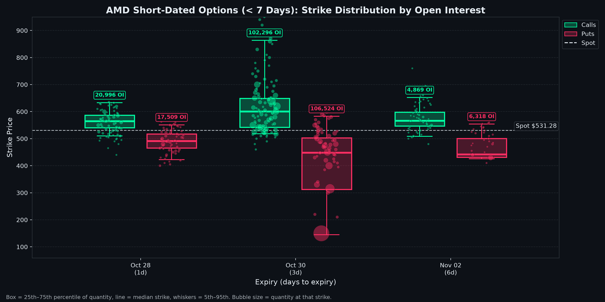
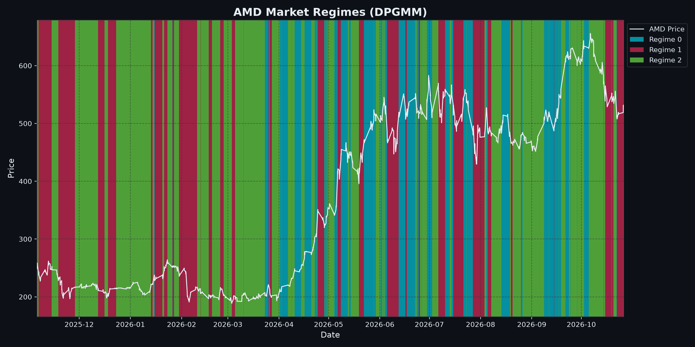

# Market Regime Analysis: AMD

> **Automated Quantitative Intelligence Report**  
> **Generated:** 2026-10-27 14:34:22 | **Project Directory:** `generations/AMD_2025-10-27_2026-10-27_fat_m3`

---

## 1. Executive Summary

| Parameter | Configuration / Result |
| :--- | :--- |
| **Ticker Symbol** | `AMD` |
| **Analysis Range** | `2025-10-27` to `2026-10-27` |
| **Total Trading Observations** | `1,700` periods |
| **Asset Profile** | Single stock |
| **Model Framework** | Student's t-Mixture Model (PyMC Fat Tails) |
| **Prior Upper Bound Regimes** | `3` |
| **Weight Concentration Prior (γ)** | `0.001` |
| **Active Regimes Discovered** | **`3` regimes** |
| **Latest Trading Date** | `2026-10-26` |
| **Latest Asset Price** | `$531.47` |
| **Current Identified Regime** | **Regime 2** |

---

## 2. Current Market Outlook & Transition Forecast

As of **2026-10-26**, `AMD` is operating in **Regime 2**.

- **Regime Stability:** There is a **85.48%** probability that the asset remains in **Regime 2** tomorrow.
- **Next-Day State Probability Distribution:**
  - $\rightarrow$ **Regime 0**: `11.72%`
  - $\rightarrow$ **Regime 1**: `2.80%`
  - $\rightarrow$ **Regime 2**: `85.48%`

---

## 3. Market Regime Distribution & Statistical Profiles

| Regime | Trading Days | Frequency (%) | Ann. Return | Ann. Volatility | Sharpe (Rf=0) | Mean Mom (50d) | Yield Spread (10Y-2Y) | Tariff Rate (%) | Regime Characterization |
| :---: | :---: | :---: | :---: | :---: | :---: | :---: | :---: | :---: | :--- |
| **Regime 0** | 385 | 22.6% | -830.17% | 51.85% | -16.01 | +5.83% | 0.42% | 2.72% | Bear Market (High Volatility / Sharp Correction) |
| **Regime 1** | 529 | 31.1% | -4.85% | 96.63% | -0.05 | -1.97% | 0.52% | 2.72% | Turbulent Consolidation (High Volatility / Choppy) |
| **Regime 2** | 786 | 46.2% | +579.07% | 47.15% | 12.28 | +0.91% | 0.52% | 2.72% | Bull Market (High Volatility / Momentum Rally) |

> Characterization thresholds (single stock): trending when annualized return is beyond **±10%**, high volatility at **25%+** annualized. Figures annualized from 1,764 bars per year.

---

## 4. Empirical Transition Probability Matrix

| Current \ Next | Regime 0 | Regime 1 | Regime 2 |
| :--- | :---: | :---: | :---: |
| **Regime 0** | **71.95%** | 6.23% | 21.82% |
| **Regime 1** | 3.02% | **91.30%** | 5.67% |
| **Regime 2** | 11.72% | 2.80% | **85.48%** |

### Regime Persistence & Expected Dwell Times

| Regime | Persistence P(S|S) | Expected Duration (Days) | Primary Exit Destination | Exit Prob (%) |
| :---: | :---: | :---: | :---: | :---: |
| Regime 0 | 71.95% | 3.6 days | Regime 2 | 21.82% |
| Regime 1 | 91.30% | 11.5 days | Regime 2 | 5.67% |
| Regime 2 | 85.48% | 6.9 days | Regime 0 | 11.72% |

---

## 5. Feature Engineering & Dataset Summary

| Feature | Count | Mean | Std Dev | Min | 25% | Median | 75% | Max |
| :--- | :---: | :---: | :---: | :---: | :---: | :---: | :---: | :---: |
| `log_return` | 1,700 | 0.0004 | 0.0163 | -0.1499 | -0.0048 | -0.0000 | 0.0052 | 0.1461 |
| `volatility` | 1,700 | 0.2304 | 0.1201 | 0.0273 | 0.1464 | 0.2073 | 0.2875 | 0.7155 |
| `momentum_50` | 1,700 | 0.0113 | 0.0618 | -0.1946 | -0.0287 | 0.0083 | 0.0488 | 0.2242 |
| `yield_spread` | 1,700 | 0.4981 | 0.1215 | 0.2000 | 0.4100 | 0.5000 | 0.5800 | 0.7400 |
| `tariff_rate` | 1,700 | 2.7200 | 0.0000 | 2.7200 | 2.7200 | 2.7200 | 2.7200 | 2.7200 |

---

## 6. Current Volatility & Options Breakdown

> **Live snapshot** taken 2026-10-27 14:34 · Spot **$531.28** · Expiries within 45 days · Source: Yahoo Finance option chains

### Key Takeaways

- **Volatility pricing:** Options are **fairly priced** vs. recent movement (IV 60.2% vs. 20d realized 52.7%).
- **Term structure:** **Flat**: no distinct near-term event priced in.
- **Expected move:** ±6.1% by 2026-11-02 ($498.78 – $563.78).
- **Positioning:** Put/call open interest is 1.01 → Defensive (puts dominate). Today's trading put/call volume is 0.67 → Bullish (calls dominate).
- **Skew:** Upside calls are bid over puts (73.1% vs. 62.8% IV): traders are chasing a rally.
- **Where the bets sit:** Call open interest clusters **far above spot** and put open interest clusters **far below spot**. Large far-from-spot clusters usually reflect hedges and lottery-ticket bets rather than an expected move.
- **Near-term levels (2026-10-30, largest short-dated expiry):** heavy put interest at **$450.00** may act as support and call interest at **$620.00** as resistance.
- **Max pain:** $532.50 (+0.2% above spot). Prices sometimes drift toward this level into expiry.

### 6.1 Volatility Snapshot

| Measure | Value | What It Means |
| :--- | :---: | :--- |
| Realized volatility (10d) | 67.6% | How much the stock actually moved over the last 10 trading days (annualized) |
| Realized volatility (20d) | 52.7% | How much the stock actually moved over the last 20 trading days (annualized) |
| Realized volatility (60d) | 57.4% | How much the stock actually moved over the last 60 trading days (annualized) |
| Front-week ATM implied vol (2026-11-02, 6d) | 63.0% | Movement priced into the nearest expiry |
| ~30-day ATM implied vol (2026-11-27, 31d) | 60.2% | Movement priced in over the next month |
| Implied / realized (20d) | 1.14x | Options are **fairly priced** vs. recent movement |
| Term structure (front − 30d) | +2.7% | **Flat**: no distinct near-term event priced in |
| Expected move by 2026-11-02 | ±$32.50 (±6.1%) | ATM straddle implies a range of **$498.78 – $563.78** |

### 6.2 Positioning by Strike Bucket

Open interest (contracts outstanding) and today's volume, grouped by how far the strike sits from the current price (expiries within 45 days).

| Strike Bucket | Strike Range | Call OI | Put OI | Put/Call (OI) | Call Volume | Put Volume | Avg IV (OI-weighted) |
| :--- | :---: | :---: | :---: | :---: | :---: | :---: | :---: |
| **Far below spot** | < $478 | 56,523 | 247,878 | 4.39 | 1,948 | 29,629 | 147.7% |
| **Below spot** | $478 – $515 | 14,338 | 54,346 | 3.79 | 6,397 | 26,875 | 67.9% |
| **Near the money** | $515 – $547 | 46,731 | 33,144 | 0.71 | 35,181 | 19,484 | 71.3% |
| **Above spot** | $547 – $584 | 46,323 | 30,400 | 0.66 | 39,668 | 3,836 | 65.4% |
| **Far above spot** | > $584 | 219,072 | 22,897 | 0.10 | 39,028 | 2,599 | 95.8% |
| **All strikes** | | **382,987** | **388,665** | **1.01** | **122,222** | **82,423** | |

### 6.3 Short-Dated Options (< 7 Days)

| Expiry | Days | Call OI | Put OI | Put/Call | Call Wall (top call OI, ±20%) | Put Wall (top put OI, ±20%) | Max Pain |
| :--- | :---: | :---: | :---: | :---: | :---: | :---: | :---: |
| 2026-10-28 | 1 | 20,996 | 17,509 | 0.83 | $600.00 | $480.00 | $527.50 |
| 2026-10-30 | 3 | 102,296 | 106,524 | 1.04 | $620.00 | $450.00 | $532.50 |
| 2026-11-02 | 6 | 4,869 | 6,318 | 1.30 | $550.00 | $430.00 | $532.50 |

---

## 7. Visualizations & Model Artifacts

### Artifact Inventory

| Artifact Description | Path |
| :--- | :--- |
| **Markdown Analysis Report** | `generations/AMD_2025-10-27_2026-10-27_fat_m3/report.md` |
| **Fitted Model & Scaler Bundle** | `generations/AMD_2025-10-27_2026-10-27_fat_m3/model.joblib` |
| **Labeled Feature Dataset** | `generations/AMD_2025-10-27_2026-10-27_fat_m3/labeled.csv` |
| **Regime Price Visualization** | `generations/AMD_2025-10-27_2026-10-27_fat_m3/plot.png` |
| **Short-Dated Options Visualization** | `generations/AMD_2025-10-27_2026-10-27_fat_m3/options.png` |

---
*Report produced by Dirichlet Process Regime Engine.*
