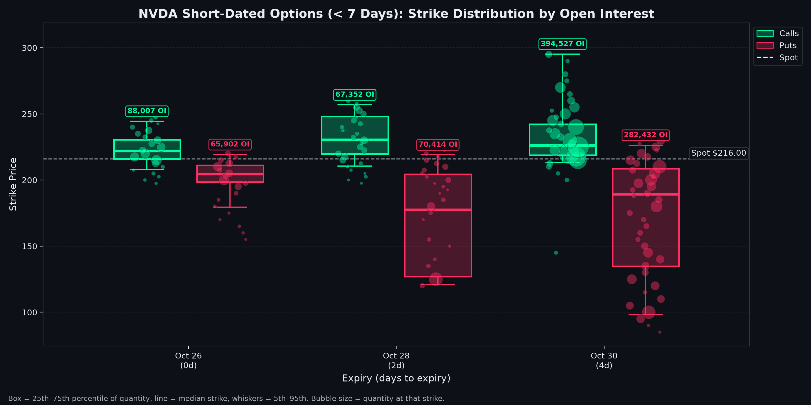
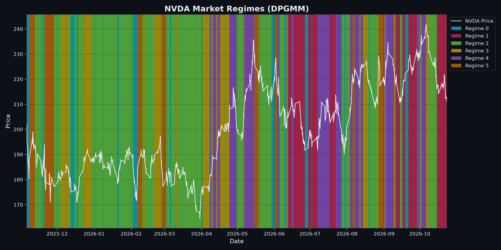

# Market Regime Analysis: NVDA

> **Automated Quantitative Intelligence Report**  
> **Generated:** 2026-10-26 22:30:44 | **Project Directory:** `generations/NVDA_2025-10-26_2026-10-26_gaussian_m6`

---

## 1. Executive Summary

| Parameter | Configuration / Result |
| :--- | :--- |
| **Ticker Symbol** | `NVDA` |
| **Analysis Range** | `2025-10-26` to `2026-10-26` |
| **Total Trading Observations** | `1,693` periods |
| **Asset Profile** | Single stock |
| **Model Framework** | Dirichlet Process Gaussian Mixture Model (DPGMM) |
| **Prior Upper Bound Regimes** | `6` |
| **Weight Concentration Prior (γ)** | `0.001` |
| **Active Regimes Discovered** | **`6` regimes** |
| **Latest Trading Date** | `2026-10-23` |
| **Latest Asset Price** | `$211.00` |
| **Current Identified Regime** | **Regime 1** |

---

## 2. Current Market Outlook & Transition Forecast

As of **2026-10-23**, `NVDA` is operating in **Regime 1**.

- **Regime Stability:** There is a **88.73%** probability that the asset remains in **Regime 1** tomorrow.
- **Next-Day State Probability Distribution:**
  - $\rightarrow$ **Regime 0**: `9.86%`
  - $\rightarrow$ **Regime 1**: `88.73%`
  - $\rightarrow$ **Regime 2**: `1.41%`

---

## 3. Market Regime Distribution & Statistical Profiles

| Regime | Trading Days | Frequency (%) | Ann. Return | Ann. Volatility | Sharpe (Rf=0) | Mean Mom (50d) | Yield Spread (10Y-2Y) | Tariff Rate (%) | Regime Characterization |
| :---: | :---: | :---: | :---: | :---: | :---: | :---: | :---: | :---: | :--- |
| **Regime 0** | 250 | 14.8% | -181.79% | 65.39% | -2.78 | -1.84% | 0.55% | 2.72% | Bear Market (High Volatility / Sharp Correction) |
| **Regime 1** | 214 | 12.6% | +53.89% | 19.28% | 2.80 | -1.00% | 0.31% | 2.72% | Bull Market (Low Volatility / Steady Expansion) |
| **Regime 2** | 583 | 34.4% | -23.80% | 15.56% | -1.53 | -1.25% | 0.55% | 2.72% | Bearish Drift (Contraction / Controlled Downtrend) |
| **Regime 3** | 207 | 12.2% | +48.42% | 13.80% | 3.51 | +2.32% | 0.54% | 2.72% | Bull Market (Low Volatility / Steady Expansion) |
| **Regime 4** | 278 | 16.4% | +81.25% | 25.55% | 3.18 | +3.49% | 0.44% | 2.72% | Bull Market (High Volatility / Momentum Rally) |
| **Regime 5** | 161 | 9.5% | +160.96% | 75.07% | 2.14 | +0.82% | 0.52% | 2.72% | Bull Market (High Volatility / Momentum Rally) |

> Characterization thresholds (single stock): trending when annualized return is beyond **±10%**, high volatility at **25%+** annualized. Figures annualized from 1,764 bars per year.

---

## 4. Empirical Transition Probability Matrix

| Current \ Next | Regime 0 | Regime 1 | Regime 2 | Regime 3 | Regime 4 | Regime 5 |
| :--- | :---: | :---: | :---: | :---: | :---: | :---: |
| **Regime 0** | **38.40%** | 7.60% | 37.60% | 6.00% | 8.00% | 2.40% |
| **Regime 1** | 9.86% | **88.73%** | 1.41% | 0.00% | 0.00% | 0.00% |
| **Regime 2** | 15.44% | 0.86% | **80.62%** | 1.37% | 0.34% | 1.37% |
| **Regime 3** | 12.56% | 0.00% | 1.45% | **85.51%** | 0.00% | 0.48% |
| **Regime 4** | 3.60% | 0.36% | 0.36% | 2.52% | **88.49%** | 4.68% |
| **Regime 5** | 3.73% | 0.00% | 7.45% | 0.00% | 6.21% | **82.61%** |

### Regime Persistence & Expected Dwell Times

| Regime | Persistence P(S|S) | Expected Duration (Days) | Primary Exit Destination | Exit Prob (%) |
| :---: | :---: | :---: | :---: | :---: |
| Regime 0 | 38.40% | 1.6 days | Regime 2 | 37.60% |
| Regime 1 | 88.73% | 8.9 days | Regime 0 | 9.86% |
| Regime 2 | 80.62% | 5.2 days | Regime 0 | 15.44% |
| Regime 3 | 85.51% | 6.9 days | Regime 0 | 12.56% |
| Regime 4 | 88.49% | 8.7 days | Regime 5 | 4.68% |
| Regime 5 | 82.61% | 5.8 days | Regime 2 | 7.45% |

---

## 5. Feature Engineering & Dataset Summary

| Feature | Count | Mean | Std Dev | Min | 25% | Median | 75% | Max |
| :--- | :---: | :---: | :---: | :---: | :---: | :---: | :---: | :---: |
| `log_return` | 1,693 | 0.0000 | 0.0090 | -0.0649 | -0.0034 | 0.0000 | 0.0035 | 0.0724 |
| `volatility` | 1,693 | 0.1331 | 0.0538 | 0.0371 | 0.0994 | 0.1269 | 0.1530 | 0.3592 |
| `momentum_50` | 1,693 | 0.0011 | 0.0324 | -0.1035 | -0.0234 | 0.0018 | 0.0217 | 0.1035 |
| `yield_spread` | 1,693 | 0.4988 | 0.1212 | 0.2000 | 0.4100 | 0.5000 | 0.5800 | 0.7400 |
| `tariff_rate` | 1,693 | 2.7200 | 0.0000 | 2.7200 | 2.7200 | 2.7200 | 2.7200 | 2.7200 |

---

## 6. Current Volatility & Options Breakdown

> **Live snapshot** taken 2026-10-26 22:30 · Spot **$216.00** · Expiries within 45 days · Source: Yahoo Finance option chains

### Key Takeaways

- **Volatility pricing:** Options are **expensive** vs. recent movement: the market expects more volatility ahead (IV 41.1% vs. 20d realized 29.2%).
- **Term structure:** **Upward sloping**: calm near term, normal uncertainty further out.
- **Expected move:** ±3.3% by 2026-10-30 ($208.78 – $223.22).
- **Positioning:** Put/call open interest is 0.81 → Balanced. Today's trading put/call volume is 0.61 → Bullish (calls dominate).
- **Skew:** Downside protection is priced at a premium (puts 42.4% vs. calls 36.3% IV): traders are paying up to hedge a drop.
- **Where the bets sit:** Call open interest clusters **far above spot** and put open interest clusters **far below spot**. Large far-from-spot clusters usually reflect hedges and lottery-ticket bets rather than an expected move.
- **Near-term levels (2026-10-30, largest short-dated expiry):** heavy put interest at **$210.00** may act as support and call interest at **$225.00** as resistance.
- **Max pain:** $215.00 (-0.5% below spot). Prices sometimes drift toward this level into expiry.

### 6.1 Volatility Snapshot

| Measure | Value | What It Means |
| :--- | :---: | :--- |
| Realized volatility (10d) | 33.0% | How much the stock actually moved over the last 10 trading days (annualized) |
| Realized volatility (20d) | 29.2% | How much the stock actually moved over the last 20 trading days (annualized) |
| Realized volatility (60d) | 35.4% | How much the stock actually moved over the last 60 trading days (annualized) |
| Front-week ATM implied vol (2026-10-30, 4d) | 36.1% | Movement priced into the nearest expiry |
| ~30-day ATM implied vol (2026-11-27, 32d) | 41.1% | Movement priced in over the next month |
| Implied / realized (20d) | 1.41x | Options are **expensive** vs. recent movement: the market expects more volatility ahead |
| Term structure (front − 30d) | -5.0% | **Upward sloping**: calm near term, normal uncertainty further out |
| Expected move by 2026-10-30 | ±$7.22 (±3.3%) | ATM straddle implies a range of **$208.78 – $223.22** |

### 6.2 Positioning by Strike Bucket

Open interest (contracts outstanding) and today's volume, grouped by how far the strike sits from the current price (expiries within 45 days).

| Strike Bucket | Strike Range | Call OI | Put OI | Put/Call (OI) | Call Volume | Put Volume | Avg IV (OI-weighted) |
| :--- | :---: | :---: | :---: | :---: | :---: | :---: | :---: |
| **Far below spot** | < $194 | 36,765 | 693,129 | 18.85 | 7,704 | 123,422 | 88.7% |
| **Below spot** | $194 – $210 | 58,571 | 301,997 | 5.16 | 32,565 | 155,189 | 45.0% |
| **Near the money** | $210 – $222 | 366,857 | 248,364 | 0.68 | 837,592 | 472,003 | 37.4% |
| **Above spot** | $222 – $238 | 423,324 | 95,762 | 0.23 | 260,656 | 30,697 | 37.4% |
| **Far above spot** | > $238 | 783,729 | 20,942 | 0.03 | 150,782 | 1,885 | 47.3% |
| **All strikes** | | **1,669,246** | **1,360,194** | **0.81** | **1,289,299** | **783,196** | |

### 6.3 Short-Dated Options (< 7 Days)

| Expiry | Days | Call OI | Put OI | Put/Call | Call Wall (top call OI, ±20%) | Put Wall (top put OI, ±20%) | Max Pain |
| :--- | :---: | :---: | :---: | :---: | :---: | :---: | :---: |
| 2026-10-26 | 0 | 88,007 | 65,902 | 0.75 | $215.00 | $200.00 | $212.50 |
| 2026-10-28 | 2 | 67,352 | 70,414 | 1.05 | $230.00 | $180.00 | $215.00 |
| 2026-10-30 | 4 | 394,527 | 282,432 | 0.72 | $225.00 | $210.00 | $215.00 |

---

## 7. Visualizations & Model Artifacts

### Artifact Inventory

| Artifact Description | Path |
| :--- | :--- |
| **Markdown Analysis Report** | `generations/NVDA_2025-10-26_2026-10-26_gaussian_m6/report.md` |
| **Fitted Model & Scaler Bundle** | `generations/NVDA_2025-10-26_2026-10-26_gaussian_m6/model.joblib` |
| **Labeled Feature Dataset** | `generations/NVDA_2025-10-26_2026-10-26_gaussian_m6/labeled.csv` |
| **Regime Price Visualization** | `generations/NVDA_2025-10-26_2026-10-26_gaussian_m6/plot.png` |
| **Short-Dated Options Visualization** | `generations/NVDA_2025-10-26_2026-10-26_gaussian_m6/options.png` |

---
*Report produced by Dirichlet Process Regime Engine.*
