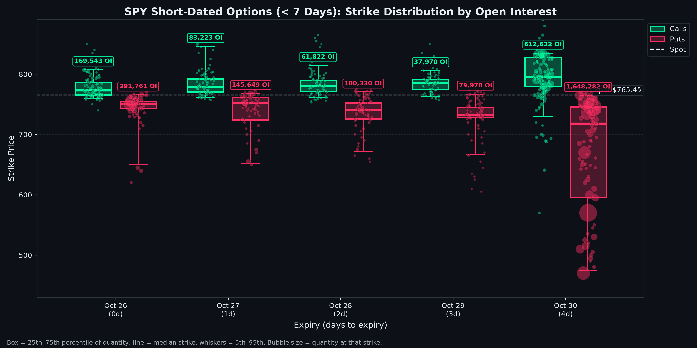
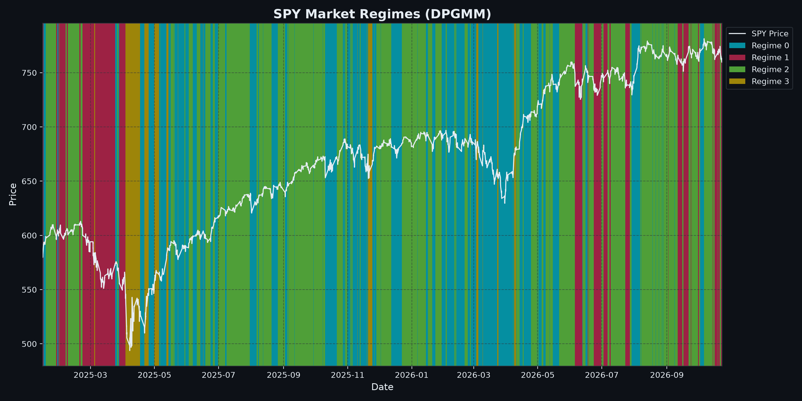

# Market Regime Analysis: SPY

> **Automated Quantitative Intelligence Report**  
> **Generated:** 2026-10-26 21:16:17 | **Project Directory:** `generations/SPY_2025-01-02_2026-10-26_gaussian_m4`

---

## 1. Executive Summary

| Parameter | Configuration / Result |
| :--- | :--- |
| **Ticker Symbol** | `SPY` |
| **Analysis Range** | `2025-01-02` to `2026-10-26` |
| **Total Trading Observations** | `3,117` periods |
| **Asset Profile** | Index fund (tighter regime thresholds) |
| **Model Framework** | Dirichlet Process Gaussian Mixture Model (DPGMM) |
| **Prior Upper Bound Regimes** | `4` |
| **Weight Concentration Prior (γ)** | `0.001` |
| **Active Regimes Discovered** | **`4` regimes** |
| **Latest Trading Date** | `2026-10-23` |
| **Latest Asset Price** | `$759.91` |
| **Current Identified Regime** | **Regime 1** |

---

## 2. Current Market Outlook & Transition Forecast

As of **2026-10-23**, `SPY` is operating in **Regime 1**.

- **Regime Stability:** There is a **81.66%** probability that the asset remains in **Regime 1** tomorrow.
- **Next-Day State Probability Distribution:**
  - $\rightarrow$ **Regime 0**: `1.31%`
  - $\rightarrow$ **Regime 1**: `81.66%`
  - $\rightarrow$ **Regime 2**: `15.50%`
  - $\rightarrow$ **Regime 3**: `1.53%`

---

## 3. Market Regime Distribution & Statistical Profiles

| Regime | Trading Days | Frequency (%) | Ann. Return | Ann. Volatility | Sharpe (Rf=0) | Mean Mom (50d) | Yield Spread (10Y-2Y) | Tariff Rate (%) | Regime Characterization |
| :---: | :---: | :---: | :---: | :---: | :---: | :---: | :---: | :---: | :--- |
| **Regime 0** | 1,081 | 34.7% | +16.10% | 13.21% | 1.22 | +0.27% | 0.54% | 2.72% | Bull Market (Low Volatility / Steady Expansion) |
| **Regime 1** | 459 | 14.7% | -21.32% | 16.97% | -1.26 | -0.82% | 0.31% | 2.72% | Bearish Drift (Contraction / Controlled Downtrend) |
| **Regime 2** | 1,356 | 43.5% | +20.30% | 4.62% | 4.39 | +0.60% | 0.49% | 2.72% | Bull Market (Low Volatility / Steady Expansion) |
| **Regime 3** | 221 | 7.1% | +54.52% | 45.58% | 1.20 | -0.26% | 0.52% | 2.72% | Bull Market (High Volatility / Momentum Rally) |

> Characterization thresholds (index fund): trending when annualized return is beyond **±5%**, high volatility at **18%+** annualized. Figures annualized from 1,764 bars per year.

---

## 4. Empirical Transition Probability Matrix

| Current \ Next | Regime 0 | Regime 1 | Regime 2 | Regime 3 |
| :--- | :---: | :---: | :---: | :---: |
| **Regime 0** | **80.94%** | 0.37% | 15.17% | 3.52% |
| **Regime 1** | 1.31% | **81.66%** | 15.50% | 1.53% |
| **Regime 2** | 11.21% | 5.53% | **82.67%** | 0.59% |
| **Regime 3** | 21.72% | 2.26% | 0.00% | **76.02%** |

### Regime Persistence & Expected Dwell Times

| Regime | Persistence P(S|S) | Expected Duration (Days) | Primary Exit Destination | Exit Prob (%) |
| :---: | :---: | :---: | :---: | :---: |
| Regime 0 | 80.94% | 5.2 days | Regime 2 | 15.17% |
| Regime 1 | 81.66% | 5.5 days | Regime 2 | 15.50% |
| Regime 2 | 82.67% | 5.8 days | Regime 0 | 11.21% |
| Regime 3 | 76.02% | 4.2 days | Regime 0 | 21.72% |

---

## 5. Feature Engineering & Dataset Summary

| Feature | Count | Mean | Std Dev | Min | 25% | Median | 75% | Max |
| :--- | :---: | :---: | :---: | :---: | :---: | :---: | :---: | :---: |
| `log_return` | 3,117 | 0.0001 | 0.0038 | -0.0405 | -0.0012 | 0.0001 | 0.0013 | 0.0483 |
| `volatility` | 3,117 | 0.0500 | 0.0351 | 0.0099 | 0.0291 | 0.0415 | 0.0601 | 0.3175 |
| `momentum_50` | 3,117 | 0.0022 | 0.0139 | -0.0993 | -0.0049 | 0.0030 | 0.0096 | 0.0435 |
| `yield_spread` | 3,117 | 0.4831 | 0.1196 | 0.2000 | 0.4000 | 0.5100 | 0.5500 | 0.7400 |
| `tariff_rate` | 3,117 | 2.7200 | 0.0000 | 2.7200 | 2.7200 | 2.7200 | 2.7200 | 2.7200 |

---

## 6. Current Volatility & Options Breakdown

> **Live snapshot** taken 2026-10-26 21:16 · Spot **$765.45** · Expiries within 45 days · Source: Yahoo Finance option chains

### Key Takeaways

- **Volatility pricing:** Options are **expensive** vs. recent movement: the market expects more volatility ahead (IV 14.5% vs. 20d realized 9.8%).
- **Term structure:** **Flat**: no distinct near-term event priced in.
- **Expected move:** ±1.4% by 2026-10-30 ($754.82 – $776.09).
- **Positioning:** Put/call open interest is 3.05 → Defensive (puts dominate). Today's trading put/call volume is 1.06 → Defensive (puts dominate).
- **Skew:** Downside protection is priced at a premium (puts 23.4% vs. calls 16.2% IV): traders are paying up to hedge a drop.
- **Where the bets sit:** Call open interest clusters **above spot** and put open interest clusters **far below spot**. Large far-from-spot clusters usually reflect hedges and lottery-ticket bets rather than an expected move.
- **Near-term levels (2026-10-30, largest short-dated expiry):** heavy put interest at **$745.00** may act as support and call interest at **$800.00** as resistance.
- **Max pain:** $765.00 (-0.1% below spot). Prices sometimes drift toward this level into expiry.

### 6.1 Volatility Snapshot

| Measure | Value | What It Means |
| :--- | :---: | :--- |
| Realized volatility (10d) | 10.8% | How much the stock actually moved over the last 10 trading days (annualized) |
| Realized volatility (20d) | 9.8% | How much the stock actually moved over the last 20 trading days (annualized) |
| Realized volatility (60d) | 10.3% | How much the stock actually moved over the last 60 trading days (annualized) |
| Front-week ATM implied vol (2026-10-30, 4d) | 14.9% | Movement priced into the nearest expiry |
| ~30-day ATM implied vol (2026-11-27, 32d) | 14.5% | Movement priced in over the next month |
| Implied / realized (20d) | 1.48x | Options are **expensive** vs. recent movement: the market expects more volatility ahead |
| Term structure (front − 30d) | +0.4% | **Flat**: no distinct near-term event priced in |
| Expected move by 2026-10-30 | ±$10.64 (±1.4%) | ATM straddle implies a range of **$754.82 – $776.09** |

### 6.2 Positioning by Strike Bucket

Open interest (contracts outstanding) and today's volume, grouped by how far the strike sits from the current price (expiries within 45 days).

| Strike Bucket | Strike Range | Call OI | Put OI | Put/Call (OI) | Call Volume | Put Volume | Avg IV (OI-weighted) |
| :--- | :---: | :---: | :---: | :---: | :---: | :---: | :---: |
| **Far below spot** | < $689 | 31,424 | 2,885,913 | 91.84 | 5,251 | 125,919 | 59.4% |
| **Below spot** | $689 – $742 | 58,807 | 1,468,657 | 24.97 | 8,819 | 326,564 | 23.0% |
| **Near the money** | $742 – $788 | 780,317 | 1,628,342 | 2.09 | 4,372,696 | 4,310,014 | 14.4% |
| **Above spot** | $788 – $842 | 967,015 | 15,738 | 0.02 | 111,423 | 1,549 | 15.7% |
| **Far above spot** | > $842 | 128,269 | 20 | 0.00 | 9,330 | 96 | 22.8% |
| **All strikes** | | **1,965,832** | **5,998,670** | **3.05** | **4,507,519** | **4,764,142** | |

### 6.3 Short-Dated Options (< 7 Days)

| Expiry | Days | Call OI | Put OI | Put/Call | Call Wall (top call OI, ±20%) | Put Wall (top put OI, ±20%) | Max Pain |
| :--- | :---: | :---: | :---: | :---: | :---: | :---: | :---: |
| 2026-10-26 | 0 | 169,543 | 391,761 | 2.31 | $765.00 | $750.00 | $763.00 |
| 2026-10-27 | 1 | 83,223 | 145,649 | 1.75 | $777.00 | $753.00 | $767.00 |
| 2026-10-28 | 2 | 61,822 | 100,330 | 1.62 | $785.00 | $741.00 | $767.00 |
| 2026-10-29 | 3 | 37,970 | 79,978 | 2.11 | $790.00 | $732.00 | $766.00 |
| 2026-10-30 | 4 | 612,632 | 1,648,282 | 2.69 | $800.00 | $745.00 | $765.00 |

---

## 7. Visualizations & Model Artifacts

### Artifact Inventory

| Artifact Description | Path |
| :--- | :--- |
| **Markdown Analysis Report** | `generations/SPY_2025-01-02_2026-10-26_gaussian_m4/report.md` |
| **Fitted Model & Scaler Bundle** | `generations/SPY_2025-01-02_2026-10-26_gaussian_m4/model.joblib` |
| **Labeled Feature Dataset** | `generations/SPY_2025-01-02_2026-10-26_gaussian_m4/labeled.csv` |
| **Regime Price Visualization** | `generations/SPY_2025-01-02_2026-10-26_gaussian_m4/plot.png` |
| **Short-Dated Options Visualization** | `generations/SPY_2025-01-02_2026-10-26_gaussian_m4/options.png` |

---
*Report produced by Dirichlet Process Regime Engine.*
