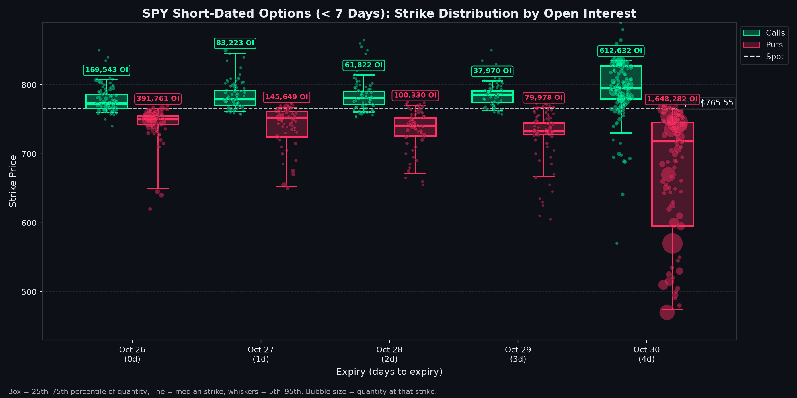
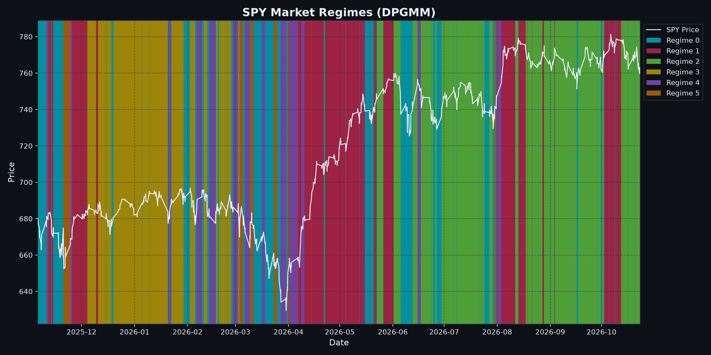

# Market Regime Analysis: SPY

> **Automated Quantitative Intelligence Report**  
> **Generated:** 2026-10-26 21:19:44 | **Project Directory:** `generations/SPY_2025-10-26_2026-10-26_gaussian_m6`

---

## 1. Executive Summary

| Parameter | Configuration / Result |
| :--- | :--- |
| **Ticker Symbol** | `SPY` |
| **Analysis Range** | `2025-10-26` to `2026-10-26` |
| **Total Trading Observations** | `1,693` periods |
| **Asset Profile** | Index fund (tighter regime thresholds) |
| **Model Framework** | Dirichlet Process Gaussian Mixture Model (DPGMM) |
| **Prior Upper Bound Regimes** | `6` |
| **Weight Concentration Prior (γ)** | `0.001` |
| **Active Regimes Discovered** | **`6` regimes** |
| **Latest Trading Date** | `2026-10-23` |
| **Latest Asset Price** | `$759.91` |
| **Current Identified Regime** | **Regime 2** |

---

## 2. Current Market Outlook & Transition Forecast

As of **2026-10-23**, `SPY` is operating in **Regime 2**.

- **Regime Stability:** There is a **84.34%** probability that the asset remains in **Regime 2** tomorrow.
- **Next-Day State Probability Distribution:**
  - $\rightarrow$ **Regime 0**: `14.32%`
  - $\rightarrow$ **Regime 1**: `1.12%`
  - $\rightarrow$ **Regime 2**: `84.34%`
  - $\rightarrow$ **Regime 5**: `0.22%`

---

## 3. Market Regime Distribution & Statistical Profiles

| Regime | Trading Days | Frequency (%) | Ann. Return | Ann. Volatility | Sharpe (Rf=0) | Mean Mom (50d) | Yield Spread (10Y-2Y) | Tariff Rate (%) | Regime Characterization |
| :---: | :---: | :---: | :---: | :---: | :---: | :---: | :---: | :---: | :--- |
| **Regime 0** | 391 | 23.1% | -72.95% | 20.27% | -3.60 | -0.69% | 0.51% | 2.72% | Bear Market (High Volatility / Sharp Correction) |
| **Regime 1** | 382 | 22.6% | +51.76% | 5.87% | 8.82 | +1.28% | 0.50% | 2.72% | Bull Market (Low Volatility / Steady Expansion) |
| **Regime 2** | 448 | 26.5% | -17.07% | 5.74% | -2.98 | -0.05% | 0.37% | 2.72% | Bearish Drift (Contraction / Controlled Downtrend) |
| **Regime 3** | 275 | 16.2% | +0.62% | 5.59% | 0.11 | +0.22% | 0.66% | 2.72% | Neutral / Range-Bound (Low Volatility Consolidation) |
| **Regime 4** | 106 | 6.3% | +41.61% | 7.22% | 5.76 | +0.37% | 0.53% | 2.72% | Bull Market (Low Volatility / Steady Expansion) |
| **Regime 5** | 91 | 5.4% | +358.61% | 30.53% | 11.75 | -0.09% | 0.52% | 2.72% | Bull Market (High Volatility / Momentum Rally) |

> Characterization thresholds (index fund): trending when annualized return is beyond **±5%**, high volatility at **18%+** annualized. Figures annualized from 1,764 bars per year.

---

## 4. Empirical Transition Probability Matrix

| Current \ Next | Regime 0 | Regime 1 | Regime 2 | Regime 3 | Regime 4 | Regime 5 |
| :--- | :---: | :---: | :---: | :---: | :---: | :---: |
| **Regime 0** | **59.08%** | 7.67% | 15.09% | 10.74% | 5.12% | 2.30% |
| **Regime 1** | 7.33% | **86.39%** | 2.88% | 0.79% | 0.00% | 2.62% |
| **Regime 2** | 14.32% | 1.12% | **84.34%** | 0.00% | 0.00% | 0.22% |
| **Regime 3** | 15.64% | 0.73% | 0.00% | **83.27%** | 0.00% | 0.36% |
| **Regime 4** | 18.87% | 1.89% | 0.94% | 0.94% | **71.70%** | 5.66% |
| **Regime 5** | 4.40% | 14.29% | 0.00% | 0.00% | 10.99% | **70.33%** |

### Regime Persistence & Expected Dwell Times

| Regime | Persistence P(S|S) | Expected Duration (Days) | Primary Exit Destination | Exit Prob (%) |
| :---: | :---: | :---: | :---: | :---: |
| Regime 0 | 59.08% | 2.4 days | Regime 2 | 15.09% |
| Regime 1 | 86.39% | 7.3 days | Regime 0 | 7.33% |
| Regime 2 | 84.34% | 6.4 days | Regime 0 | 14.32% |
| Regime 3 | 83.27% | 6.0 days | Regime 0 | 15.64% |
| Regime 4 | 71.70% | 3.5 days | Regime 0 | 18.87% |
| Regime 5 | 70.33% | 3.4 days | Regime 1 | 14.29% |

---

## 5. Feature Engineering & Dataset Summary

| Feature | Count | Mean | Std Dev | Min | 25% | Median | 75% | Max |
| :--- | :---: | :---: | :---: | :---: | :---: | :---: | :---: | :---: |
| `log_return` | 1,693 | 0.0001 | 0.0031 | -0.0244 | -0.0012 | 0.0001 | 0.0013 | 0.0223 |
| `volatility` | 1,693 | 0.0453 | 0.0212 | 0.0099 | 0.0305 | 0.0409 | 0.0548 | 0.1312 |
| `momentum_50` | 1,693 | 0.0017 | 0.0115 | -0.0322 | -0.0059 | 0.0016 | 0.0085 | 0.0386 |
| `yield_spread` | 1,693 | 0.4988 | 0.1212 | 0.2000 | 0.4100 | 0.5000 | 0.5800 | 0.7400 |
| `tariff_rate` | 1,693 | 2.7200 | 0.0000 | 2.7200 | 2.7200 | 2.7200 | 2.7200 | 2.7200 |

---

## 6. Current Volatility & Options Breakdown

> **Live snapshot** taken 2026-10-26 21:19 · Spot **$765.55** · Expiries within 45 days · Source: Yahoo Finance option chains

### Key Takeaways

- **Volatility pricing:** Options are **expensive** vs. recent movement: the market expects more volatility ahead (IV 14.3% vs. 20d realized 9.8%).
- **Term structure:** **Flat**: no distinct near-term event priced in.
- **Expected move:** ±1.4% by 2026-10-30 ($754.97 – $776.14).
- **Positioning:** Put/call open interest is 3.05 → Defensive (puts dominate). Today's trading put/call volume is 1.06 → Defensive (puts dominate).
- **Skew:** Downside protection is priced at a premium (puts 23.5% vs. calls 16.1% IV): traders are paying up to hedge a drop.
- **Where the bets sit:** Call open interest clusters **above spot** and put open interest clusters **far below spot**. Large far-from-spot clusters usually reflect hedges and lottery-ticket bets rather than an expected move.
- **Near-term levels (2026-10-30, largest short-dated expiry):** heavy put interest at **$745.00** may act as support and call interest at **$800.00** as resistance.
- **Max pain:** $765.00 (-0.1% below spot). Prices sometimes drift toward this level into expiry.

### 6.1 Volatility Snapshot

| Measure | Value | What It Means |
| :--- | :---: | :--- |
| Realized volatility (10d) | 10.8% | How much the stock actually moved over the last 10 trading days (annualized) |
| Realized volatility (20d) | 9.8% | How much the stock actually moved over the last 20 trading days (annualized) |
| Realized volatility (60d) | 10.3% | How much the stock actually moved over the last 60 trading days (annualized) |
| Front-week ATM implied vol (2026-10-30, 4d) | 14.8% | Movement priced into the nearest expiry |
| ~30-day ATM implied vol (2026-11-27, 32d) | 14.3% | Movement priced in over the next month |
| Implied / realized (20d) | 1.47x | Options are **expensive** vs. recent movement: the market expects more volatility ahead |
| Term structure (front − 30d) | +0.5% | **Flat**: no distinct near-term event priced in |
| Expected move by 2026-10-30 | ±$10.59 (±1.4%) | ATM straddle implies a range of **$754.97 – $776.14** |

### 6.2 Positioning by Strike Bucket

Open interest (contracts outstanding) and today's volume, grouped by how far the strike sits from the current price (expiries within 45 days).

| Strike Bucket | Strike Range | Call OI | Put OI | Put/Call (OI) | Call Volume | Put Volume | Avg IV (OI-weighted) |
| :--- | :---: | :---: | :---: | :---: | :---: | :---: | :---: |
| **Far below spot** | < $689 | 31,424 | 2,885,913 | 91.84 | 5,271 | 126,118 | 59.4% |
| **Below spot** | $689 – $743 | 58,807 | 1,468,657 | 24.97 | 8,831 | 329,154 | 23.0% |
| **Near the money** | $743 – $789 | 780,317 | 1,628,342 | 2.09 | 4,419,957 | 4,366,108 | 14.5% |
| **Above spot** | $789 – $842 | 967,015 | 15,738 | 0.02 | 111,795 | 1,551 | 15.7% |
| **Far above spot** | > $842 | 128,269 | 20 | 0.00 | 9,333 | 96 | 22.8% |
| **All strikes** | | **1,965,832** | **5,998,670** | **3.05** | **4,555,187** | **4,823,027** | |

### 6.3 Short-Dated Options (< 7 Days)

| Expiry | Days | Call OI | Put OI | Put/Call | Call Wall (top call OI, ±20%) | Put Wall (top put OI, ±20%) | Max Pain |
| :--- | :---: | :---: | :---: | :---: | :---: | :---: | :---: |
| 2026-10-26 | 0 | 169,543 | 391,761 | 2.31 | $765.00 | $750.00 | $763.00 |
| 2026-10-27 | 1 | 83,223 | 145,649 | 1.75 | $777.00 | $753.00 | $767.00 |
| 2026-10-28 | 2 | 61,822 | 100,330 | 1.62 | $785.00 | $741.00 | $767.00 |
| 2026-10-29 | 3 | 37,970 | 79,978 | 2.11 | $790.00 | $732.00 | $766.00 |
| 2026-10-30 | 4 | 612,632 | 1,648,282 | 2.69 | $800.00 | $745.00 | $765.00 |

---

## 7. Visualizations & Model Artifacts

### Artifact Inventory

| Artifact Description | Path |
| :--- | :--- |
| **Markdown Analysis Report** | `generations/SPY_2025-10-26_2026-10-26_gaussian_m6/report.md` |
| **Fitted Model & Scaler Bundle** | `generations/SPY_2025-10-26_2026-10-26_gaussian_m6/model.joblib` |
| **Labeled Feature Dataset** | `generations/SPY_2025-10-26_2026-10-26_gaussian_m6/labeled.csv` |
| **Regime Price Visualization** | `generations/SPY_2025-10-26_2026-10-26_gaussian_m6/plot.png` |
| **Short-Dated Options Visualization** | `generations/SPY_2025-10-26_2026-10-26_gaussian_m6/options.png` |

---
*Report produced by Dirichlet Process Regime Engine.*
